# Sequence va Activity Diagram cho cac Use Case

Tai lieu nay duoc ve tu code hien tai va file UC. Mot so quy trinh UC-14 co the xu ly qua ca VNPay Return va IPN de dam bao tinh idempotent.

## UC-11 View Loyalty Points

<!-- mermaid-checked: every participant uses `participant Id as "Label"`, no \n in aliases/messages/notes, every alt/opt/loop closed by end, no `:` inside any alias -->
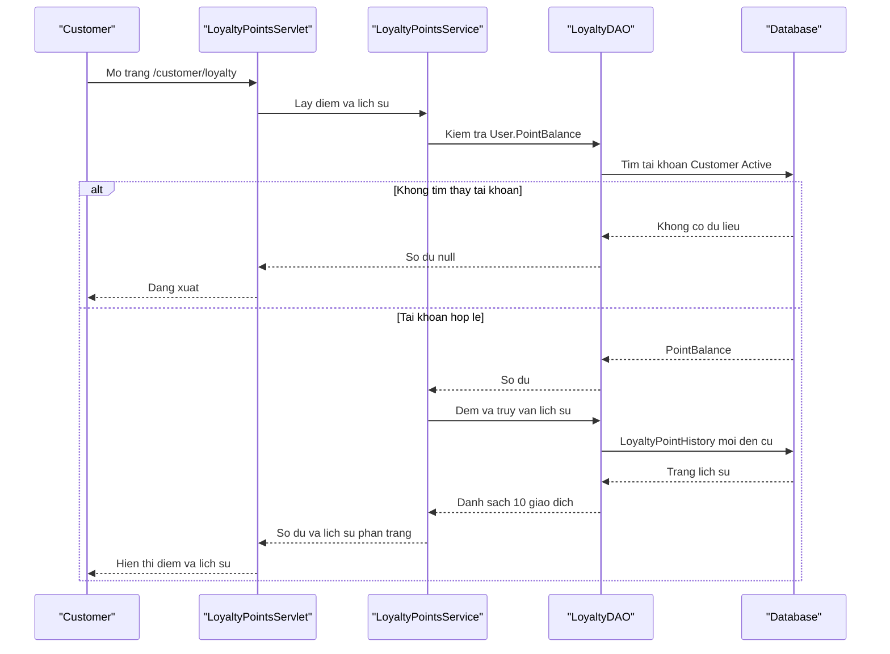

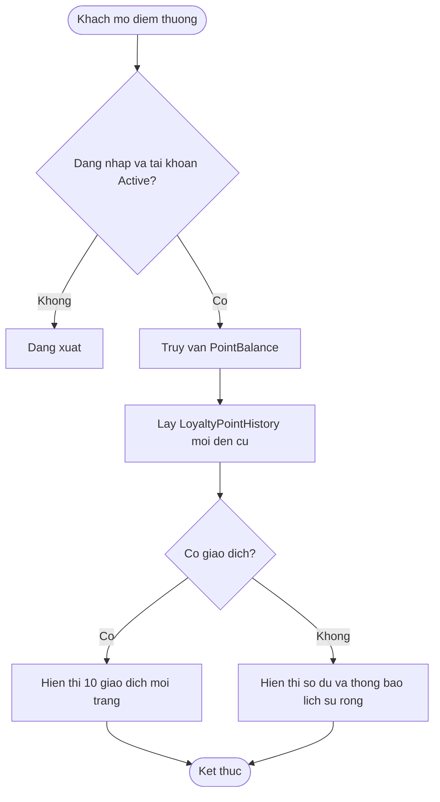

## UC-12 View Voucher Wallet

<!-- mermaid-checked: every participant uses `participant Id as "Label"`, no \n in aliases/messages/notes, every alt/opt/loop closed by end, no `:` inside any alias -->
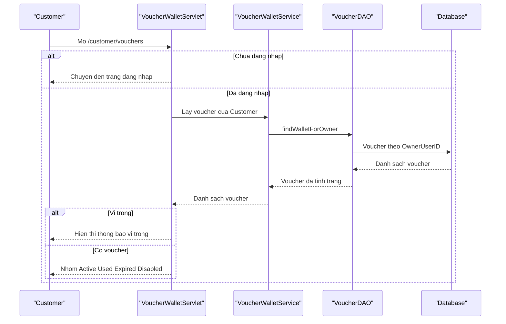

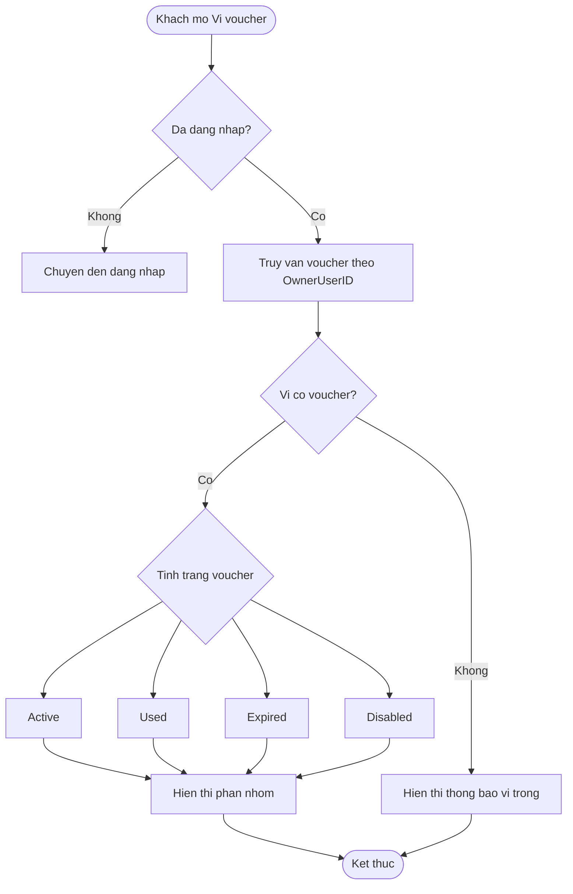

## UC-14 Make Online Payment

<!-- mermaid-checked: every participant uses `participant Id as "Label"`, no \n in aliases/messages/notes, every alt/opt/loop closed by end, no `:` inside any alias -->
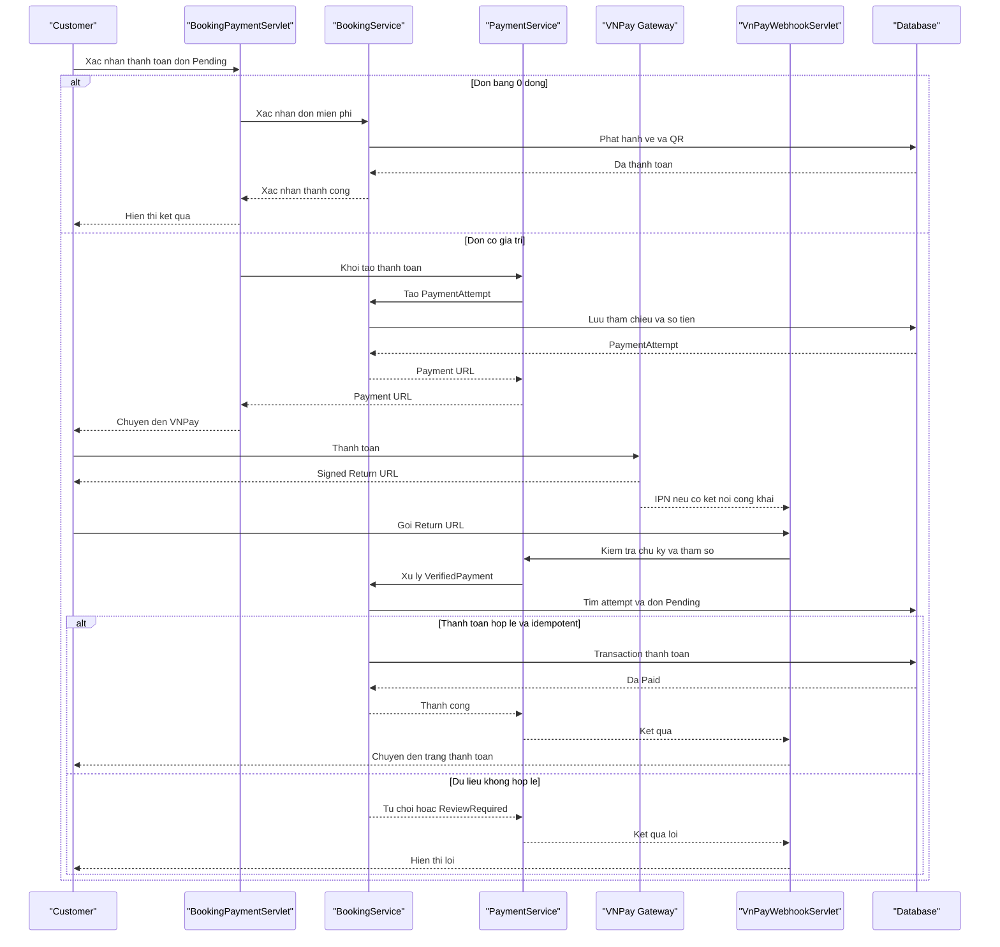

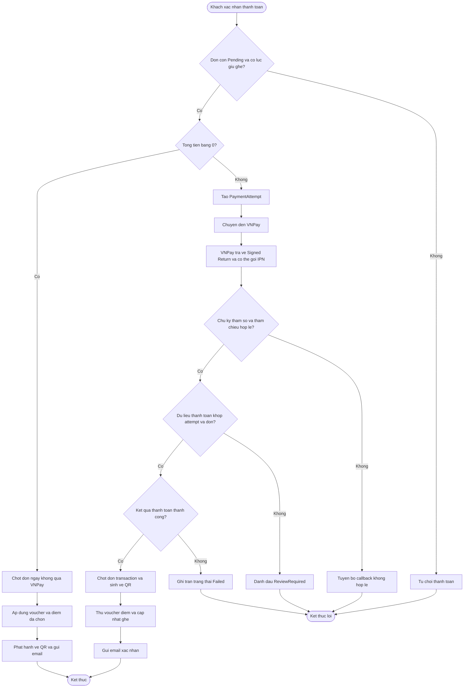

## UC-15 View Booking History

<!-- mermaid-checked: every participant uses `participant Id as "Label"`, no \n in aliases/messages/notes, every alt/opt/loop closed by end, no `:` inside any alias -->
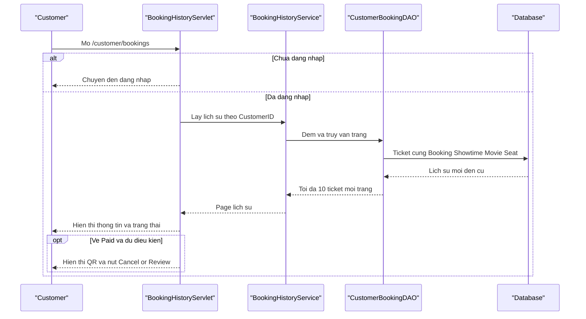

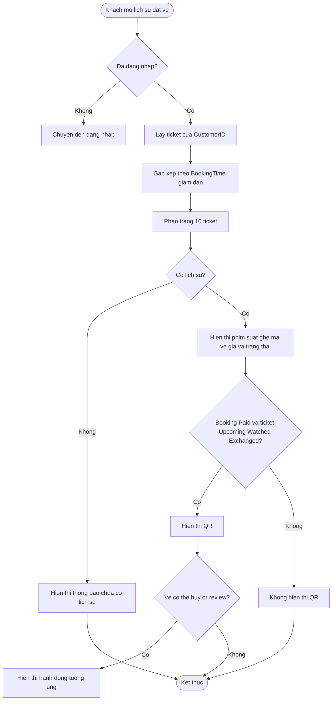

## UC-16 Cancel Ticket Online

<!-- mermaid-checked: every participant uses `participant Id as "Label"`, no \n in aliases/messages/notes, every alt/opt/loop closed by end, no `:` inside any alias -->
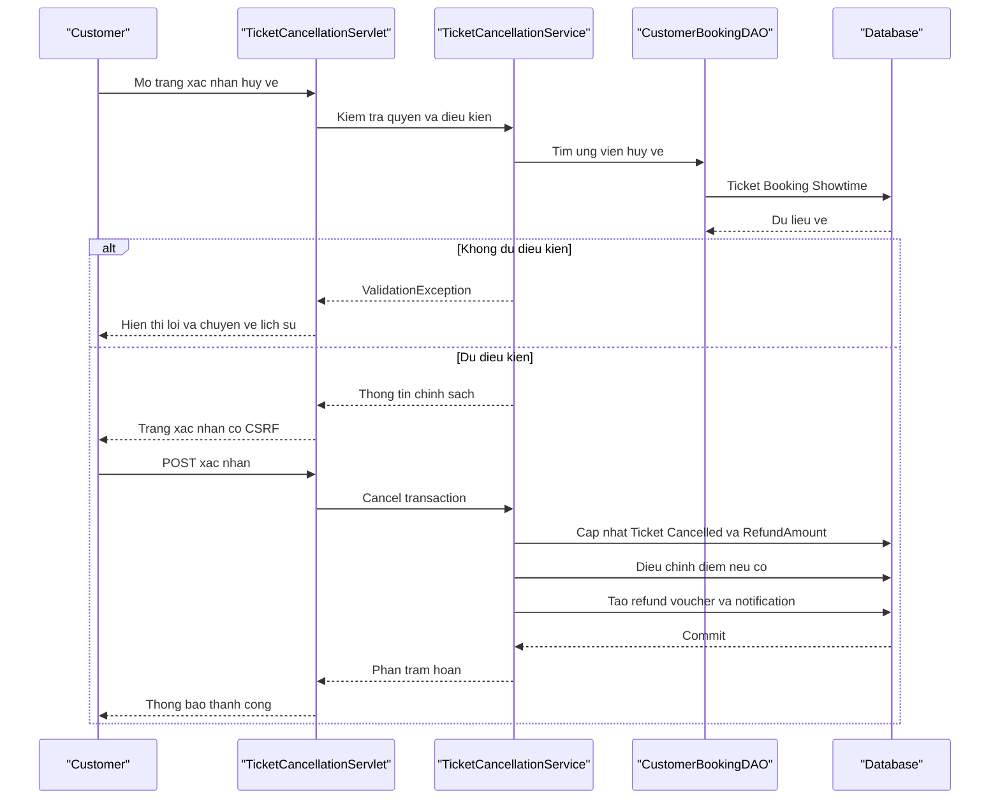

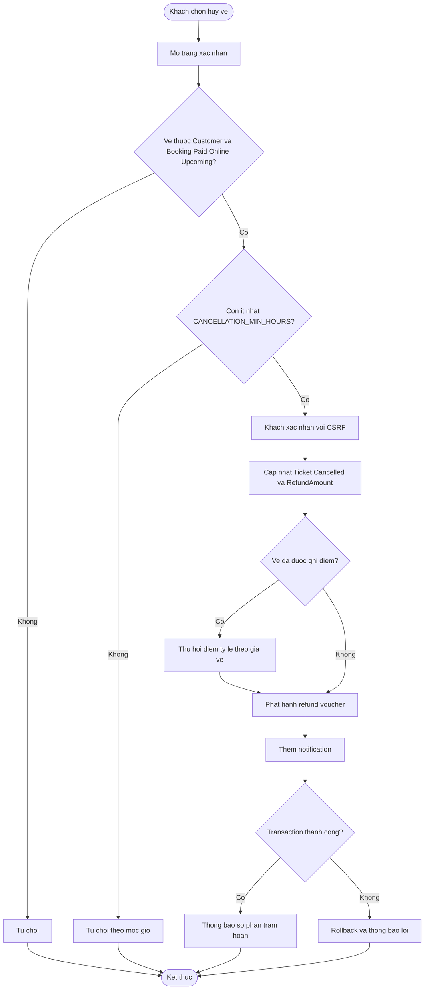

> Luu y theo code hien tai: UC-16 chua cap nhat Seat trong transaction huy ve. Tai lieu khong the ghi Seat duoc tra ve Available cho den khi code xu ly diem nay duoc bo sung.

## UC-18 View Notifications

<!-- mermaid-checked: every participant uses `participant Id as "Label"`, no \n in aliases/messages/notes, every alt/opt/loop closed by end, no `:` inside any alias -->
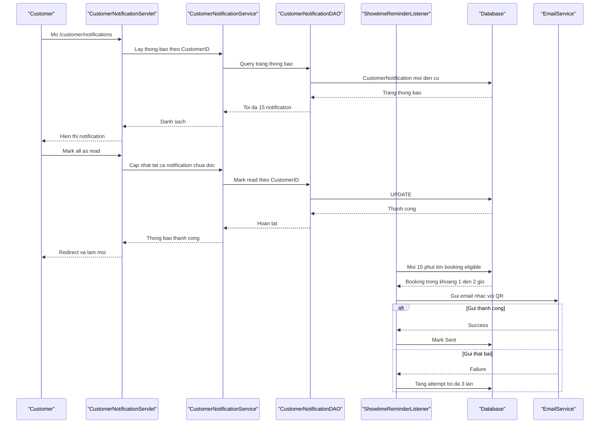

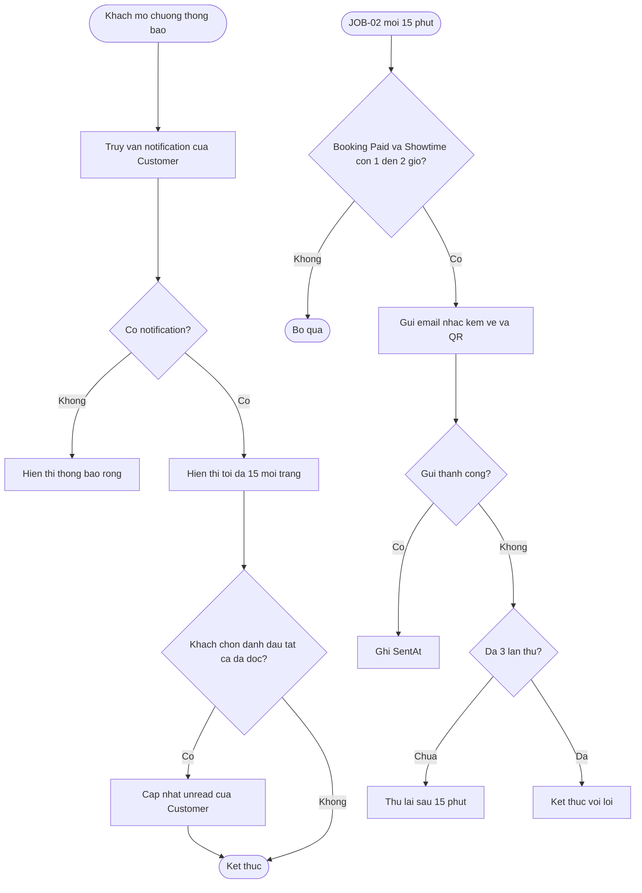

## UC-28 Manage Vouchers and Promotions

<!-- mermaid-checked: every participant uses `participant Id as "Label"`, no \n in aliases/messages/notes, every alt/opt/loop closed by end, no `:` inside any alias -->
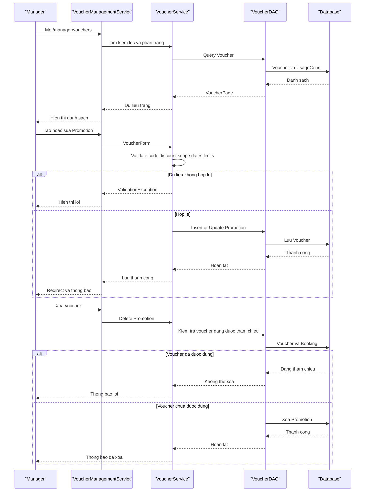

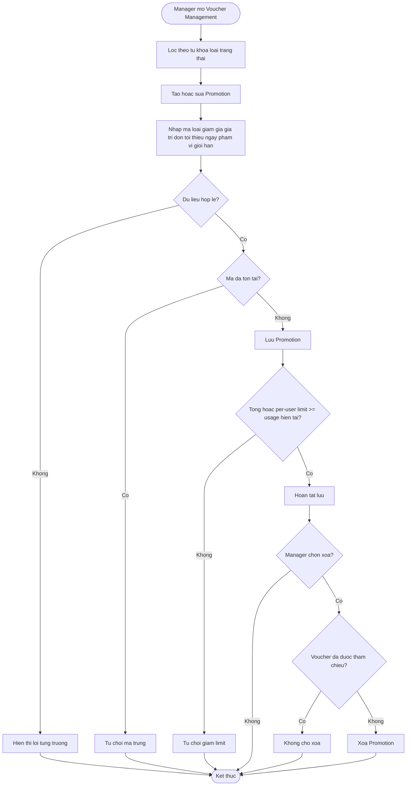
